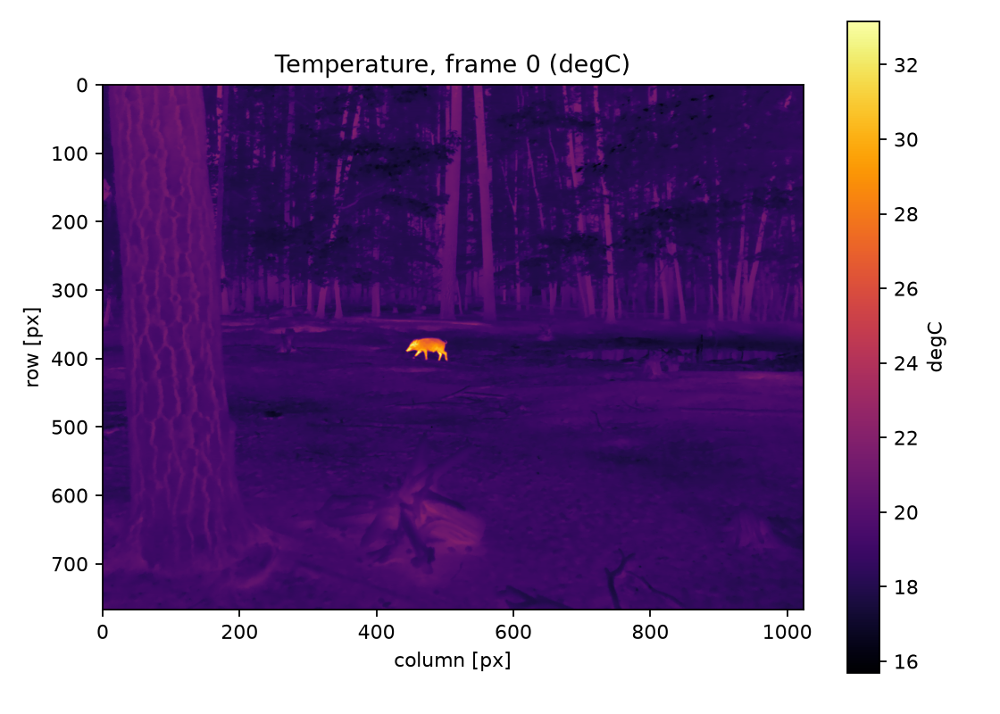

# Validation and test report

Two different questions have to be kept apart:

1. **Is the implementation correct and self-consistent?** — answered by the automated suite on
   synthetic recordings with known ground truth.
2. **Does it decode and calibrate *my* camera correctly?** — answered only by a real recording and,
   for absolute accuracy, by an independent reference such as FLIR Research Studio.

This document reports both, and says plainly which parts remain open.

Environment for the numbers below: Linux 6.17 (x86-64), Python 3.14.7, numpy 2.5.4, h5py 3.16.0,
imagecodecs 2026.10.10, PySide6, flirpy 0.6.2, ExifTool 12.76.

## 1. Automated suite

```
$ pytest
100 passed in 7.7 s
```

| # | requirement (from the task) | where it is tested |
|---|---|---|
| 1 | file identification and validation | `test_decoder.py::test_non_csq_file_is_rejected`, `test_empty_file_is_rejected`, `test_magic_and_record_offsets_are_consistent` |
| 2 | CSQ frame extraction | `test_decoder.py::test_jpegls_payload_roundtrips_exactly`, `test_uncompressed_payload_decodes_to_identical_counts`, `test_two_codecs_agree_on_the_same_payload` |
| 3 | frame ordering | `test_decoder.py::test_frame_order_is_preserved`, `test_conversion.py::test_frame_subset_and_stride_keep_order` |
| 4 | correct array dimensions | `test_conversion.py::test_ground_truth_temperatures_are_recovered` (shape equality), `test_decoder.py::test_geometry_change_is_detected` |
| 5 | calibration metadata extraction | `test_decoder.py::test_camera_record_matches_what_was_written`, `test_conversion.py::test_metadata_contains_the_scientific_essentials` |
| 6 | temperature conversion | `test_radiometry.py::test_object_correction_recovers_the_forward_model`, `test_object_correction_equals_planck_inversion_for_a_blackbody`, `test_atmospheric_transmission_decreases_with_distance_and_stays_bounded` |
| 7 | Celsius unit correctness | `test_radiometry.py::test_apparent_temperature_is_in_celsius`, `test_conversion.py::test_timestamps_preserve_camera_clock_units_and_are_exact` (unit attribute), `test_exporter.py::test_hdf5_layout_dtypes_and_chunks` |
| 8 | HDF5 output integrity | `test_exporter.py::test_hdf5_layout_dtypes_and_chunks`, `test_conversion.py::test_verification_detects_a_corrupted_cube`, `test_cli.py::test_verify_command_reports_pass` |
| 9 | NumPy output integrity | `test_exporter.py::test_npy_export_is_a_memmapped_float32_cube`, `test_conversion.py::test_all_formats_together` |
| 10 | missing / malformed metadata | `test_radiometry.py::test_missing_parameters_raise_instead_of_being_guessed`, `test_missing_planck_constants_are_reported_by_name`, `test_auto_mode_falls_back_to_apparent_with_a_warning`, `test_decoder.py::test_camera_info_of_truncated_record_does_not_raise` |
| 11 | incomplete recordings | `test_decoder.py::test_truncated_last_frame_is_marked_not_silently_dropped`, `test_garbage_between_frames_is_skipped_with_a_warning`, `test_conversion.py::test_incomplete_recording_converts_complete_frames_only` |
| 12 | memory-efficient processing | `test_performance.py::test_peak_memory_does_not_grow_with_frame_count` (peak RSS between 40 and 600 frames), `test_conversion_speed_is_reasonable` |
| 13 | timestamp preservation | `test_decoder.py::test_timestamps_are_read_per_frame_with_millisecond_resolution`, `test_conversion.py::test_timestamps_preserve_camera_clock_units_and_are_exact`, `test_estimates_are_labelled_when_the_file_has_no_clock` |
| 14 | conversion reproducibility | `test_conversion.py::test_conversion_is_reproducible_bit_for_bit` |
| — | headless batch mode (directory input, resume, error isolation, logs) | `test_batch.py` (25 tests): discovery, naming/tree preservation, corrupt-file isolation, skip/resume on unchanged files, reconversion after a change, `--overwrite`, settings invalidation, dry run, duplicate names, state/log/summary artefacts, "batch does not import Qt", CLI `--input-dir` interface and exit codes |

Additional safety properties covered by the suite: `ConversionCancelled` leaves no output file;
existing outputs are never overwritten without `--overwrite`; a recording whose frame geometry
changes mid-file is refused rather than mixed into one cube; `raw-only` export requires HDF5 and
produces no `temperature_C` dataset.

### Synthetic accuracy

Recordings built with **known temperatures**, converted end to end, compared with the truth
(6 frames, 48×64, JPEG-LS payload, 30 Hz clock):

| case | mode used | max abs error | mean abs error |
|---|---|---|---|
| ε = 1.0 (Planck only) | object (correction is identity) | **0.0032 °C** | 0.0016 °C |
| ε = 0.92, 1.0 m, RH 60 % | object | **0.0035 °C** | 0.0017 °C |

The residual is the uint16 quantisation of the counts (~0.007 °C per count for these Planck
constants). This proves the forward model and the inversion agree; it proves nothing about a
particular camera's calibration.

### Batch / server mode

The batch path is covered by the same synthetic recordings, driven exactly as on a server: a
directory containing good files, a nested file, a corrupt file and an uncalibrated file. Verified
properties: three files converted while one failed; re-running converts nothing and rewrites
nothing; a changed recording is detected by size/mtime/head/tail hash and re-converted; deleting an
output rebuilds it; a corrupted state file does not abort the run; logs, `batch_summary.json` and
the state file are written; and importing the batch module does **not** import Qt (so it runs on a
machine with no display libraries). The wrapper scripts are syntax-checked in CI and
`run_server.sh` is executed there against a synthetic two-file tree.

## 2. Real recording: FLIR T1020 `.csq`

No T540 file was available. A **public T1020 recording** (`hog.csq`, published by the
AlexanderProd/csq project as its example) was used instead: 22 frames, 1024×768, JPEG-LS payload,
serial 72502433, lens FOL21, recorded 2022-07-21. It is not committed to this repository; the
download and every number below can be reproduced with the commands at the end.

### 2.1 Metadata vs ExifTool (independent implementation)

All 20 mapped fields are byte-for-byte equal (within float formatting):

| field | ExifTool | flir-csq |
|---|---|---|
| CameraModel | FLIR T1020 | FLIR T1020 |
| CameraSerialNumber | 72502433 | 72502433 |
| LensModel / FieldOfView | FOL21 / 44.64° | FOL21 / 44.64° |
| Emissivity | 1.00 | 1.0 |
| ObjectDistance | 20.0 m | 20.0 m |
| Reflected / Atmospheric / Window temperature | 20 / 21 / 30 °C | 20 / 21 / 30 °C |
| IRWindowTransmission | 1 | 1.0 |
| RelativeHumidity | 0.40 | 0.40 |
| PlanckR1 / B / F / O / R2 | 11895.471 / 1328.9 / 1 / −3869 / 0.013583817 | identical |
| RawValueRangeMin / Max | 5589 / 53132 | 5589 / 53132 |
| FrameRate | 30 | 30 |

`scripts/validate_against_exiftool.py` prints this table and asserts the matches.

### 2.2 Payload identity

The raw-thermal payload extracted by `exiftool -b -RawThermalImage` and the payload this decoder
reads from the frame's RawData record are **the same bytes**:

```
exiftool_sha256  8d3cce4b1d475481f374c89c12ccac0b5c8e76f0d7a846318bfb9edc9b7bd507
flir_csq_sha256  8d3cce4b1d475481f374c89c12ccac0b5c8e76f0d7a846318bfb9edc9b7bd507
bytes            198848
```

Decoded with two independent codecs (imagecodecs/CharLS and pylibjpeg-libjpeg) the arrays are
identical for frames 0, 11 and 21.

### 2.3 Temperatures

Converted cube: `(22, 768, 1024)`, mode `object` (ε = 1, τ = 0.982 at 20 m, RH 40 %).

| quantity | flir-csq | flirpy `raw2temp` with ExifTool constants |
|---|---|---|
| frame 0 min / max | 15.69 / 33.16 °C | 15.59 / 33.37 °C |
| cube min / max | 15.54 / 33.60 °C | — |
| mean of frame means | 18.85 °C | — |
| **max abs difference** | — | **0.21 °C** |
| **mean abs difference** | — | 0.04 °C |

The residual is the atmospheric modelling choice described in `calibration.md` §3 (flirpy treats
the FLIR expression as a half-path transmittance and applies it twice; this implementation applies
FLIR's full-path expression once). It is a modelling difference, not a calibration or decoding
difference — the payload and every constant agree exactly.

The scene is a plausible outdoor thermal image: ground and trees 16–22 °C, a small animal at
~32 °C, smooth background gradients. A wrong count decode or a wrong Planck inversion does not
produce that.



*Frame 0 rendered from `/temperature_C` of the converted cube (no colour video involved: each
pixel is a number produced by the Planck inversion).*

### 2.4 Timing

22 frames, camera clock 2022-07-21T21:49:06.468Z → 21:49:07.168Z, measured **30.0 Hz**, matching
the camera's declared 30 Hz. Timestamps are stored both as seconds since the first converted frame
and as absolute epoch milliseconds.

## 3. FLIR T540: what is verified, what is pending

**Verified by construction on real hardware of the same family:** container framing (FFF blocks),
JPEG-LS payloads, CameraInfo offsets, Planck conversion, per-frame timestamps, and the fact that
dimensions and codec are read from the file rather than assumed (the T1020 test is 1024×768, so
nothing in the code depends on 464×348).

**Not verified, because no T540 file exists here:**

1. that a T540 writes the same FFF/JPEG-LS container (expected: FLIR documents `.csq` for T5xx
   identically, and the T1020 sample is the same family);
2. that its CameraInfo record has the same length/offsets (ExifTool's table is camera-generation
   independent, but a new firmware could move fields);
3. that a per-frame timestamp is present (if absent, the tool reports timestamps as *estimated*
   from the declared frame rate and says so in the metadata — it never invents a clock);
4. that the absolute temperatures match FLIR Research Studio for the same recording.

### Checklist for the first real T540 file (15 minutes)

```bash
python convert_csq.py recording.csq --inspect
```

* `resolution` must print `464 x 348` (or the camera's native size — the tool does not force it);
* `payload` must print `imagecodecs/CharLS (JPEG-LS)`; any other codec is reported, not guessed;
* `radiometry` must print `calibrated` with a Planck block and a non-zero `raw_value_range`;
* `duration` and `first frame` must show a camera clock; if they show "estimated", the file has no
  timestamps;
* `frames` must equal the number of frames the camera says it recorded.

Then convert and compare with FLIR Research Studio:

1. open the same `.csq` in Research Studio, place a spot on a flat, high-emissivity target and note
   the temperature, plus the emissivity/distance/RH shown in the software;
2. `python convert_csq.py recording.csq --inspect` and check that the same parameters were read
   from the file;
3. `python convert_csq.py recording.csq -o results --save-raw`, then
   `python examples/read_hdf5.py results/recording_temperature.h5`;
4. read the same pixel from the cube and report the difference. Expect agreement within the
   camera's accuracy specification (~±2 °C or 2 %, whichever is greater, for a T5xx) when the
   parameters match; a larger gap means the parameters differ (usually emissivity or distance).

Until that comparison exists, treat T540 output as **container-correct and calibration-faithful to
the file, accuracy-unverified**.

## 4. Decoder limitations

* **Only radiometric payloads.** Colourised JPEG/PNG/MP4 exports contain no measurement data and
  are refused.
* **JPEG-LS profile.** Standard JPEG-LS (SOF55) is decoded. A hypothetical camera firmware using
  JPEG 2000, JPEG-XL or a proprietary delta codec inside the RawData record would be reported as
  an unsupported payload, with the byte signature printed, rather than mis-decoded.
* **No gain/dead-pixel map application.** The `0x21`/`0x22` auxiliary records (gain map, dead
  pixels, palette) are listed, not applied: they modify presentation, and the measurement counts
  are already what the camera calibrated. A camera that writes a *bad-pixel map that must* be
  applied before radiometry would need an explicit implementation.
* **No lens-distortion or spatial calibration.** The tool converts counts to °C per pixel; it does
  not map pixels to millimetres.
* **Truncated tail.** The last block is converted only if complete; a partial block is reported.
* **Verified timestamp layout.** If a camera puts the clock elsewhere, timestamps are reported as
  estimated rather than wrong.

## 5. Reproducing this report

```bash
# automated suite
pytest -q

# synthetic ground truth
python convert_csq.py --demo /tmp/demo.csq --output /tmp/demo_out
python examples/read_hdf5.py /tmp/demo_out/demo_temperature.h5

# real recording cross-check (needs exiftool, flirpy, and the public sample)
gdown 13oGxBDKDb_l-7rfmZ_nuTFfdV8ycADhm -O hog.csq      # or download it in a browser
python convert_csq.py hog.csq -o /tmp/val
python scripts/validate_against_exiftool.py hog.csq --h5 /tmp/val/hog_temperature.h5
```

The sample is public material published by the AlexanderProd/csq project. It is used here only as
an independent test vector and is not redistributed in this repository.
